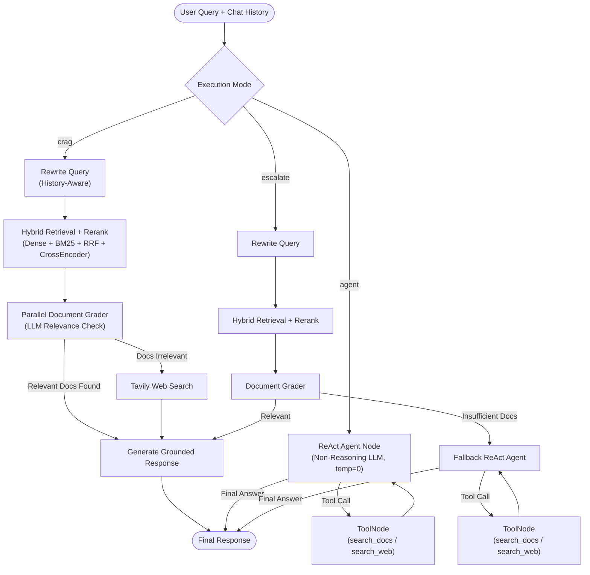

# Multi-Document Conversational RAG Assistant

A production-oriented **Tri-Modal Agentic & Corrective RAG** platform built with **LangGraph**, **ChromaDB**, **BM25s**, **Cross-Encoder Reranking**, and **SQLite Checkpointing**. Designed for high-precision multi-document QA with configurable execution modes (**CRAG**, **Agentic ReAct**, and **Adaptive Escalate**) and systematically benchmarked on a 60-question evaluation suite.


---

## 1. Core Problems & Solutions

* **Multi-Turn Context Loss:** Follow-up questions with pronoun ambiguity (e.g., *"What is its complexity?"*) degrade direct vector search. Solved via a **History-Aware Query Rewriter** backed by persistent SQLite thread state.
* **Cross-Document Contamination:** Indexing multiple PDFs globally introduces semantic noise. Solved via **Metadata-Filtered Retrieval (`selected_files`)**, allowing users and agents to scope search dynamically to specific documents.
* **Dense Retrieval Ceiling:** Pure dense embeddings struggle with exact lexical terms, acronyms, and numbers. Solved via **Contextual Chunk Enrichment**, **Hybrid Search (Dense + BM25s via RRF)**, and **Cross-Encoder Reranking** (`ms-marco-MiniLM-L-6-v2`).
* **Out-of-Scope Hallucinations & Rigid Pipelines:** Single-pass RAG either hallucinates on missing context or fails on multi-hop questions. Solved via **Corrective Document Grading (CRAG)**, **Tavily Web Fallback**, and an **Adaptive Escalation Gateway** that hands off failed retrievals to an autonomous **ReAct Agent**.

---

## 2. Tri-Modal Architecture

The system exposes three distinct reasoning architectures through a unified factory (`src/main.py` -> `get_pipeline(mode)`):

| Mode | Architecture | Best For |
| :--- | :--- | :--- |
| **`crag`** | **Corrective RAG (Single-Pass)** | Fast, deterministic document QA with parallel chunk grading and web fallback. |
| **`agent`** | **Pure ReAct Agent (Multi-Hop)** | Complex cross-document comparisons and multi-step reasoning via tool calling. |
| **`escalate`** | **Adaptive Hybrid Escalation** | Balanced production default: takes the fast CRAG path first and escalates to the ReAct Agent only if document grading fails. |



---

## 3. Tech Stack

| Layer | Technology | Role |
| :--- | :--- | :--- |
| **Orchestration** | **LangGraph** (`StateGraph`, `ToolNode`) | Cyclic agent loops, conditional routing, and state persistence. |
| **LLM Engine** | **OpenAI** (Non-Reasoning LLM) | Configured with `temperature=0.0` and `reasoning_effort="none"` for strict context adherence, tool calling, and low inference cost. |
| **Embeddings & Vector Store** | `text-embedding-3-small` + **ChromaDB** | Persistent dense vector index with metadata filtering. |
| **Sparse Retrieval & Rerank** | **BM25s** + **Cross-Encoder** | Lexical matching fused via RRF (`k=20`), reranked to `top_k=3` with `ms-marco-MiniLM-L-6-v2`. |
| **Ingestion & Enrichment** | **PyMuPDF** + **Contextual Retrieval** | SHA-256 deduplication, recursive chunking (`1000/200`), and parallel chunk context enrichment. |
| **Web Search** | **Tavily** (`langchain-tavily`) | Out-of-scope web fallback with deterministic record-and-replay caching for reproducible evals. |
| **Persistence & UI** | **SQLite Checkpointer** + **Streamlit** | Thread-safe `AsyncFriendlySqliteSaver` bridging synchronous SQLite reads with async `app.astream()` execution. |

---

## 4. Evaluation & Benchmark Results

### Methodology
* **Dataset:** 60 structured test queries across 3 academic papers (`arxiv1.pdf`, `arxiv2.pdf`, `arxiv3.pdf`) — comprising 50 document-grounded questions, 10 out-of-scope questions, and 20 multi-turn conversational follow-ups.
* **LLM-as-a-Judge:** Automated Pydantic-enforced scoring on a 1–5 scale for **Faithfulness** (zero hallucination) and **Relevance** (intent alignment).
* **Execution:** Async concurrent evaluation (`asyncio.Semaphore`) with recursion protection (`recursion_limit=10`) and component-level latency/token telemetry.

### Current Production Benchmarks (`gpt-6-luna`, `temperature=0.0`, `reasoning_effort="none"`)

| Architecture / Mode | Faithfulness (0-5) | Relevance (0-5) | Multi-Turn Score | Avg Gen Latency | P95 Gen Latency | Avg Tokens / Query | Avg Cost / Query | Total Cost (60 Queries) |
| :--- | :---: | :---: | :---: | :---: | :---: | :---: | :---: | :---: |
| **CRAG (Single-Pass)** | 4.72 | 4.93 | **4.95** | **6.94 s** | **10.53 s** | 2,369 | **$0.00027** | **$0.0164** |
| **Adaptive Escalate (Hybrid)** | **4.81** *(+0.09)* | 4.95 | **4.95** | **7.23 s** | 15.50 s | 2,904 | **$0.00034** | **$0.0205** |
| **Pure ReAct Agent (Multi-Hop)** | **4.90** | **4.98** | 4.85 | 9.98 s | 35.21 s | 3,472 | **$0.00046** | **$0.0279** |

### Key Engineering Findings
1. **Latency vs. Accuracy Trade-off:**
   * **CRAG** delivers the lowest latency (**6.94 s**) for straightforward document queries.
   * **Adaptive Escalate** adds only **+0.29 s** on average (**7.23 s**) while recovering failed retrievals via fallback agent routing, lifting Faithfulness from **4.72 $\rightarrow$ 4.81**.
   * **Pure ReAct Agent** achieves the highest Faithfulness (**4.90**) and Relevance (**4.98**) through iterative multi-hop tool calls, at the cost of higher tail latency (P95: **35.21 s**).
2. **Non-Reasoning Determinism (`reasoning_effort="none"`):**
   * Unconstrained reasoning models frequently extrapolate beyond retrieved passages (over-inference) and reject `temperature=0.0` or standard chat-completion tool calls. Disabling internal reasoning tokens (`reasoning_effort="none"`) restores strict `temp=0.0` determinism, tool-calling compatibility, and keeps inference at the `$0.10 / $0.50` cost tier.

> *For full architectural trade-offs, ablation studies, and historical benchmarks (V1–V5), see [decisions.md](decisions.md) and [`eval/benchmarks/`](eval/benchmarks/).*

---

## 5. Project Structure

```text
multidoc_rag_assistant/
├── app_gui.py                         # Streamlit UI (3 modes + AsyncFriendlySqliteSaver)
├── decisions.md                       # Architectural decisions & full benchmark history
├── requirements.txt                   # Pinned dependencies
├── .env.example                       # API key template
│
├── src/
│   ├── main.py                        # Unified CLI entrypoint & get_pipeline() factory
│   ├── config.py                      # Centralized model, retrieval & path settings
│   ├── prompt.py                      # Rewriter, Grader, and Synthesis prompts
│   ├── utils.py                       # Document formatting, hashing & history helpers
│   ├── ingestion/
│   │   └── ingestion.py               # PyMuPDF + Contextual Chunking + Dual Indexing
│   ├── retrieval/
│   │   ├── bm25.py                    # BM25s sparse retriever
│   │   ├── hybrid_search.py           # RRF fusion retriever
│   │   ├── reranker.py                # Cross-Encoder reranking
│   │   ├── pipeline.py                # Unified retrieve_and_rerank() pipeline
│   │   └── web.py                     # Tavily search + deterministic replay cache
│   ├── graph/
│   │   ├── state.py                   # Shared CRAG/Escalate state schema
│   │   ├── nodes.py                   # Rewrite, Retrieve, Grade, Web, Generate & Fallback nodes
│   │   ├── crag.py                    # Mode 1: CRAG StateGraph
│   │   └── escalate.py                # Mode 3: Adaptive Escalate StateGraph
│   └── agent/
│       ├── agent_state.py             # ReAct agent state schema
│       ├── agent_prompt.py            # Boundary-aware agent system prompt
│       ├── tools.py                   # Scoped search_docs & search_web tools
│       ├── nodes.py                   # Tool-bound agent node
│       └── pipeline.py                # Mode 2: ReAct Agent StateGraph
│
├── eval/
│   ├── retrieval/                     # Hit Rate & MRR retrieval benchmarks
│   ├── generation/
│   │   ├── gen_evaluation.py          # Async LLM-as-a-Judge harness (--mode)
│   │   ├── prompts.py                 # Judge rubric & structured prompt
│   │   └── schemas.py                 # Pydantic schemas (RunMetadata, CRAGTelemetry)
│   └── benchmarks/                    # Archived JSON reports (V1 to V5)
│
└── data/
    ├── arxiv1.pdf, arxiv2.pdf, arxiv3.pdf
    ├── ground_truth.json              # 60-query evaluation dataset
    └── tavily_search_results.json     # Cached web search responses
```

---

## 6. Quickstart & Usage

### Prerequisites
* Python 3.10+
* OpenAI API Key
* Tavily API Key

### Installation
```bash
# 1. Clone the repository
git clone https://github.com/denizzozupek/multi-doc-rag-assistant.git
cd multi-doc-rag-assistant

# 2. Create and activate a virtual environment
python -m venv .venv
# Windows:
.venv\Scripts\activate
# Linux/macOS:
source .venv/bin/activate

# 3. Install dependencies
pip install -r requirements.txt

# 4. Configure environment variables
cp .env.example .env
# Add your OPENAI_API_KEY and TAVILY_API_KEY inside .env
```

### First-Time Document Ingestion
On a fresh clone, the local indexes (`data/vector_db/`, `data/bm25_index/`) and conversation store (`data/graph.db`) do not exist yet—they are generated automatically when you ingest your first document.

* **Option A — Upload via Streamlit UI (Recommended):** Launch `streamlit run app_gui.py` and upload any PDF file(s) from the sidebar. The app automatically computes SHA-256 hashes (preventing duplicate embeddings), enriches chunks with document context, and builds both the ChromaDB vector store and BM25s index.
* **Option B — Ingest via CLI (Before running `src.main`):**
  ```bash
  # Ingest your own PDF file
  python -m src.ingestion.ingestion --pdf path/to/your_document.pdf

  # Or ingest the included sample paper (default)
  python -m src.ingestion.ingestion
  ```

### Running the Streamlit UI
```bash
streamlit run app_gui.py
```
Select between **CRAG**, **Agentic**, or **Escalate** directly from the sidebar, upload PDFs, scope specific files, and persist conversations across sessions via SQLite.

### Running via Unified CLI
```bash
# Interactive chat in Escalate mode
python -m src.main --mode escalate

# Single query with step-by-step node streaming
python -m src.main --mode agent --query "Compare the price of anarchy definitions across documents" --stream
```

### Running the Evaluation Suite
```bash
# Evaluate CRAG, Agent, or Escalate mode across all 60 queries
python -m eval.generation.gen_evaluation --mode crag
python -m eval.generation.gen_evaluation --mode agent
python -m eval.generation.gen_evaluation --mode escalate
```
